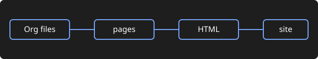

#+title: A Picture and Some Code
#+date: [2026-04-02 Thu]
#+tags: emacs code

A figure with a caption, and code coloured by the same theme as the rest of the site. The first post, [[file:hello-world.org]], has the plain version.

#+caption: How a build goes: Org files become pages, pages become HTML, HTML becomes the site.
#+attr_html: :alt Four boxes in a row joined by arrows: Org files, pages, HTML, site.

* Some Emacs Lisp

#+begin_src emacs-lisp
(defun example-greeting (name)
  "Return a greeting for NAME."
  ;; Strings, keywords and comments each get their colour.
  (format "Hello, %s!" name))
#+end_src

* And a shell command

#+begin_src sh
just example-build && just example-serve
#+end_src
